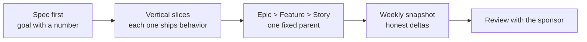
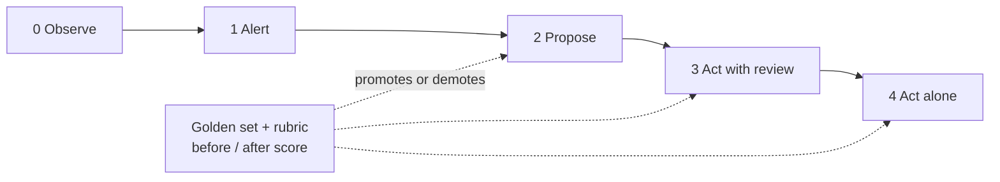

## Hi, I'm Benjamin

Product leader based in São Paulo, building AI products and agents. Native French, fluent English and Portuguese.

I work on the part of AI products that decides whether they survive contact with real users: how an agent earns autonomy, what it is allowed to write to the system of record, and how the work is broken down so a team can ship it. This profile holds the methods I use, written as reusable skills with fictional examples.

**Open to:** Head of AI Product, Senior AI PM, Director or Group PM. Remote, US or Europe.

## What I publish here

| Project | What it shows |
|---|---|
| [**backlog-writing-system**](https://github.com/Benyoumen/backlog-writing-system) | A complete method to write Epics, Features and User Stories, from PRD to weekly cadence. 14 skills, 10 templates, a worked example. |
| [**agent-design-principles**](https://github.com/Benyoumen/agent-design-principles) | UX rules for agents that act for a person: autonomy tiers gated by evals, the write contract, dense operator screens. |
| [**pm-deck-and-writing-skills**](https://github.com/Benyoumen/pm-deck-and-writing-skills) | Editorial rules and a QA pipeline for decks and project messages, plus an anti-AI-slop rewrite guide. |

## How I think about a backlog

## How I think about agent autonomy

All examples in these repos use a fictional product and fictional data. Nothing here comes from a customer or an employer.
