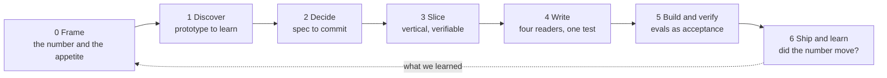
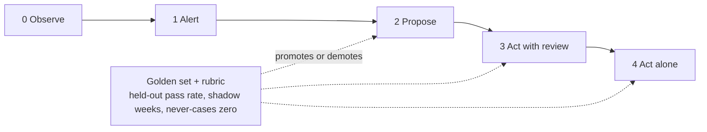

## About me

Product leader based in São Paulo, focused on one question: how AI makes products and teams work better, measurably.

Fifteen years building and scaling digital products, from early-stage ideas to a B2B SaaS platform used by thousands of real estate businesses, as VP Product & Growth, CEO and founder. Since 2023 I build AI products and agentic systems, and I teach product, executive and engineering teams how to work with them.

### What I build

- **Agentic systems in production.** A multi-agent system that cut account research and meeting preparation from up to two days to about thirty minutes, with 90% adoption in the sales teams that use it. A WhatsApp sales workflow that answers 100% of first contacts for 2,000 to 3,000 leads a month and took the win rate from 20% to 42%. An internal MCP server that connects a company's tools and data with external tools. The pattern is the same each time: deterministic orchestration where the process is known, a model only where judgment is needed, and every write to the system of record under a contract.
- **The harness around the model.** The model is the smallest part of an agent product. Quality is decided by the harness: the tools and data the agent may reach, the context it is given, the evals that gate each tier of autonomy, and the governance that tracks business KPIs, agent performance, human-in-the-loop controls and cost. That layer is where I spend my time.
- **Autonomy that is earned.** An agent gets to act alone tier by tier, on evals and shadow time, never on a demo. Irreversible actions stay capped until someone accepts the cost of an error in writing.
- **Discovery before delivery.** A 14-day discovery and process redesign with a baseline KPI, prototype validation, then a 60 to 90 day production cycle. The baseline is what turns "AI is helping" from an opinion into a measurement.
- **Specs that people and coding agents can build from.** Why it exists, what it must never do, how it is verified. The whole method is public below.

### Taste is the scarce input

AI made output free, and the default output is generic: the same gradients, the same phrasing, the same layouts, the same hundred tickets. I treat that as a defect, in writing and in design. Visual slop costs credibility the moment a customer, a candidate or a board member opens the page. I have led UX/UI designers and a website product used by thousands of businesses, and today I design and build the sites and prototypes myself, with AI tools and a no-slop standard for both the words and the screens. The rules I use for that are published here.

### Teaching

AI adoption programs I co-designed and delivered reached about 3,000 leaders, product managers and developers, including executive education with FGV, Secovi-SP and LARES. The same material runs inside the teams I lead: internal tools, agentic workflows, AI-assisted development.

## What you'll find here

<table>
  <tr>
    <td width="50%" valign="top">
      
      
<b>Backlog Writing System.</b> A complete method from problem frame to weekly cadence: 18 skills, 14 templates, a fictional product run through every stage, and evals as acceptance criteria for AI behavior. <a href="https://benyoumen.github.io/backlog-writing-system/">Field guide</a> · <a href="https://github.com/Benyoumen/backlog-writing-system/blob/main/docs/manifesto.md">Manifesto</a>

    </td>
    <td width="50%" valign="top">
      
      
<b>NextStone.</b> A product concept built end to end: a marketplace where real estate developers meet investment funds, four roles, each with its own dashboard. <a href="https://benyoumen.github.io/nextstone-concept/">Live demo</a> · <a href="https://github.com/Benyoumen/nextstone-concept#readme">Problem, decision, proof, next</a>

    </td>
  </tr>
  <tr>
    <td width="50%" valign="top">
      
      
<b>Agent Design Principles.</b> How an agent earns autonomy on evals, the write contract between a screen and the system of record, and design rules for dense operator screens. <a href="https://github.com/Benyoumen/agent-design-principles/blob/main/docs/principles.md">Principles</a>

    </td>
    <td width="50%" valign="top">
      
      
<b>PM Deck and Writing Skills.</b> Editorial rules, a build pipeline with QA gates, and the anti-slop rewrite pass for decks and project messages. The sample deck is rendered with its own rules. <a href="https://benyoumen.github.io/pm-deck-and-writing-skills/">Live deck</a>

    </td>
  </tr>
</table>

Also here: practical product management methods, frameworks for building and evaluating agents, templates for discovery, prioritization and delivery, and examples of AI-native product workflows. Every example uses a fictional product and fictional data. Nothing comes from a customer or an employer.

## How I work

## Background

- 15+ years in product, B2B SaaS, growth and digital platforms. Former VP Product & Growth, CEO and founder.
- Two master's degrees in law and an MBA in real estate management (ESSEC). Trained in Paris, based in São Paulo, working internationally.
- Native French, fluent English and Portuguese.

## Open to

**Head of AI Product · Director of Product · Head of Product · Group PM · Senior AI PM**

Remote roles across the US, Europe and Latin America.
