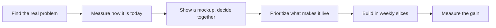

<h1 align="center">Hi, I'm Ben 👋</h1>

<b>Product leader in São Paulo. I find the problem worth solving, prioritize what makes it live, and build it with AI, without the slop.</b>

## About me

17 years building and scaling digital products, from early-stage ideas to a B2B SaaS platform used by thousands of real estate businesses, as VP Product & Growth, CEO and founder. Since 2023 I build AI products and agentic systems, I teach product, executive and engineering teams to work with them, and I spend most of my energy on the two things that decide whether any of it pays off: finding the real problem, and prioritizing the work so the team finds its pace.

### What I build: agentic systems with a measured return

The most recent sales AI solution I built is a multi-agent system that automates and accelerates the sales workflow, helping teams prospect faster, prioritize the right accounts, prepare for meetings, manage opportunities, keep CRM data current, and generate proactive pipeline insights and forecasts. It researches and qualifies accounts, identifies similar customers worth prospecting, prioritizes opportunities, and prepares sellers for meetings. Work that could previously take up to two days can now be completed in around 30 minutes. Adoption reached 90% across the teams using it, saving each salesperson roughly one to two hours per day.

The design principle was simple: keep deterministic steps where the process is known, use AI only where judgment adds value, and require human approval before an agent can write to the system of record until it has earned a higher level of autonomy. We also defined the business KPI before building, so success was measured against an agreed baseline rather than by how much output the agents produced.

### Two ways I work, one discipline

- **Forward-deployed.** Inside a client's operation, building a tailored solution on their data and workflows: discovery and process redesign, a baseline KPI, prototype validation, then production.
- **Product building.** A product for many customers, where discovery means interviews, prototypes and a Now / Next / Later roadmap driven by user value, KPI impact and expected ROI.

Same objective in both: solve a real problem, create measurable value for users, define the KPI before building, estimate the ROI, and prioritize what creates the most impact first.

### Prioritization is half the job

Epics, Features, User Stories and tasks, placed in Now / Next / Later and prioritized by user value, KPI impact, expected ROI, effort and dependencies. The goal is to find the shortest path to meaningful value: sometimes a small feature comes first because it unlocks a much higher-impact capability. Functional and technical specs are rendered as readable HTML so developers, QA and non-technical sponsors can understand what is being built, why it matters and which KPI it should move. Sprint simulations connect Fibonacci points, team capacity and delivery dates to those priorities.

### Visual AI slop is manageable

AI can build a screen in minutes, but the default result often looks like every other AI screen. That quickly reduces credibility. Product Managers need enough design judgment to create prototypes that feel real, use realistic data and communicate value clearly. A readable HTML mockup, validated with users and stakeholders before production code, is one of the fastest ways to test whether an idea creates enough user value and expected ROI to deserve a place on the roadmap.

### Teaching

AI adoption programs I co-designed and delivered reached about 3,000 leaders, Product Managers and developers, including executive education with FGV, Secovi-SP and LARES. The focus: identifying high-value AI use cases, connecting them to KPIs and ROI, redesigning workflows and helping teams prioritize what is actually worth building.

## What you'll find here

<table>
  <tr>
    <td width="50%" valign="top">
      
      
<b>Backlog Writing System.</b> From problem frame to weekly cadence: Now / Next / Later with ROI impact and the enabling chain, readable spec previews, a live capacity simulation, evals as acceptance criteria for AI behavior. 21 skills, a fictional product run through every stage. <a href="https://benyoumen.github.io/backlog-writing-system/">Field guide</a> · <a href="https://benyoumen.github.io/backlog-writing-system/capacity.html">Capacity simulator</a>

    </td>
    <td width="50%" valign="top">
      
      
<b>No-slop design.</b> The visual tells of generated screens and what to do instead, the mockup-first workflow, and live mockups built on real-looking data, each next to its generic version. <a href="https://benyoumen.github.io/no-slop-design/">Mockup gallery</a> · <a href="https://github.com/Benyoumen/no-slop-design/blob/main/docs/visual-slop-tells.md">The tells</a>

    </td>
  </tr>
  <tr>
    <td width="50%" valign="top">
      
      
<b>NextStone.</b> A product concept built end to end: a marketplace where real estate developers meet investment funds, four roles, each with its own dashboard. <a href="https://benyoumen.github.io/nextstone-concept/">Live demo</a> · <a href="https://github.com/Benyoumen/nextstone-concept#readme">Problem, decision, proof, next</a>

    </td>
    <td width="50%" valign="top">
      
      
<b>Agent Design Principles.</b> How an agent earns autonomy on evidence, the write contract between a screen and the system of record, and design rules for screens people use all day. <a href="https://github.com/Benyoumen/agent-design-principles/blob/main/docs/principles.md">Principles</a>

    </td>
  </tr>
  <tr>
    <td width="50%" valign="top">
      
      
<b>PM Deck and Writing Skills.</b> Editorial rules, a build pipeline with QA gates, and the anti-slop rewrite pass for decks and project messages. The sample deck is rendered with its own rules. <a href="https://benyoumen.github.io/pm-deck-and-writing-skills/">Live deck</a>

    </td>
    <td width="50%" valign="top">
      
      
<b>Readable spec preview.</b> A functional and technical spec rendered as one page a developer, a QA and a sponsor can all read: one plain sentence per item, numbered sections, a glossary, phases and the schedule. <a href="https://benyoumen.github.io/backlog-writing-system/spec-preview.html">Open the example</a>

    </td>
  </tr>
</table>

Every example uses a fictional product and fictional data. Nothing comes from a customer or an employer.

## How I work, in plain words

*One loop, repeated. The number measured at the end is the first line of the next problem.*

*How an AI agent earns trust. Each step up needs proof: tests on real cases, weeks of shadow use, zero forbidden actions.*

## Background

- Seventeen years in product, B2B SaaS, growth and digital platforms. Former VP Product & Growth, CEO and founder.
- Two master's degrees in law and an MBA in real estate management (ESSEC). Trained in Paris, based in São Paulo, working internationally.
- Native French, fluent English and Portuguese.

## Open to

**Head of AI Product · Director of Product · Head of Product · Group PM · Senior AI PM**

Remote roles across the US, Europe and Latin America.
