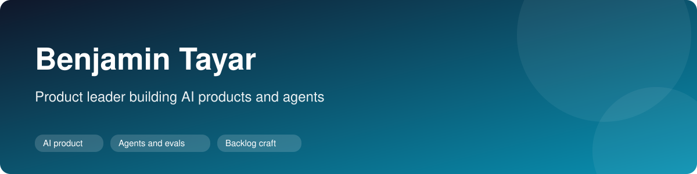
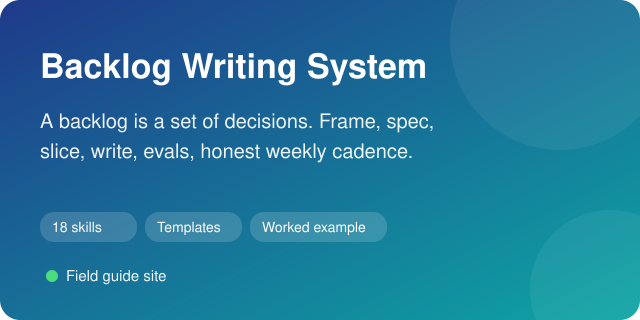
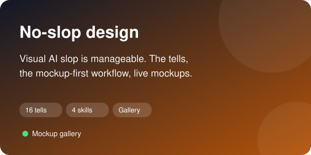
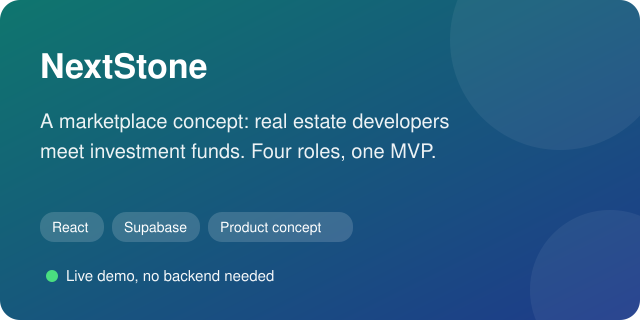
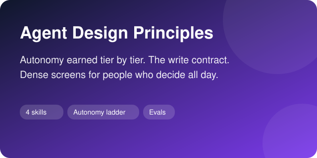
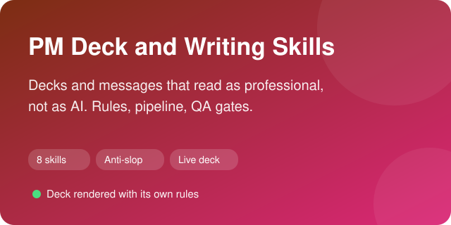
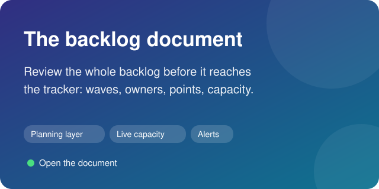
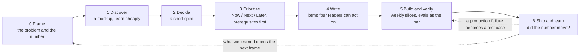
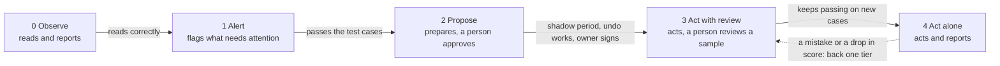

<h1 align="center">Hi, I'm Ben 👋</h1>

<b>Product leader in São Paulo. I find the problem worth solving, prioritize what makes it live, and build it with AI, without the slop.</b>

## About me

17 years building and scaling digital products, from early-stage ideas to a B2B SaaS platform used by thousands of real estate businesses, as VP Product & Growth, CEO and founder. Since 2023 I build AI products and agentic systems, I teach product, executive and engineering teams to work with them, and I spend most of my energy on the two things that decide whether any of it pays off: finding the real problem, and prioritizing the work so the team finds its pace.

### What I build: agentic systems with a measured return

The most recent sales AI solution I built is a multi-agent system that automates and accelerates the sales workflow, helping teams prospect faster, prioritize the right accounts, prepare for meetings, manage opportunities, keep CRM data current, and generate proactive pipeline insights and forecasts. It researches and qualifies accounts, identifies similar customers worth prospecting, prioritizes opportunities, and prepares sellers for meetings. Work that could previously take up to two days can now be completed in around 30 minutes. Adoption reached 90% across the teams using it, saving each salesperson roughly one to two hours per day.

The design principle was simple: keep deterministic steps where the process is known, use AI only where judgment adds value, and require human approval before an agent can write to the system of record until it has earned a higher level of autonomy. We also defined the business KPI before building, so success was measured against an agreed baseline rather than by how much output the agents produced.

### Two ways I work, one discipline

- **Forward-deployed.** Inside a client's operation, building a tailored solution on their data and workflows: discovery and process redesign, a baseline KPI, prototype validation, then production.
- **Product building.** A product for many customers, where discovery means interviews, prototypes and a Now / Next / Later roadmap driven by user value, KPI impact and expected ROI.

Same objective in both: solve a real problem, create measurable value for users, define the KPI before building, estimate the ROI, and prioritize what creates the most impact first.

### Prioritization is half the job

Epics, Features, User Stories and tasks, placed in Now / Next / Later and prioritized by user value, KPI impact, expected ROI, effort and dependencies. The goal is to find the shortest path to meaningful value: sometimes a small feature comes first because it unlocks a much higher-impact capability. Functional and technical specs are rendered as readable HTML so developers, QA and non-technical sponsors can understand what is being built, why it matters and which KPI it should move. Sprint simulations connect Fibonacci points, team capacity and delivery dates to those priorities. The whole backlog is reviewed in a generated document before anything reaches DevOps or Jira, with the sprint planning run inside it: owners and Fibonacci points per story, each developer's points against their capacity and the team's against the sprint limit, live, with an alert the moment someone is over. A board shows one card at a time; the document shows the why, the waves and the capacity together.

### Visual AI slop is manageable

AI can build a screen in minutes, but the default result often looks like every other AI screen. That quickly reduces credibility. Product Managers need enough design judgment to create prototypes that feel real, use realistic data and communicate value clearly. A readable HTML mockup, validated with users and stakeholders before production code, is one of the fastest ways to test whether an idea creates enough user value and expected ROI to deserve a place on the roadmap.

### Teaching

AI adoption programs I co-designed and delivered reached about 3,000 leaders, Product Managers and developers, including executive education with FGV, Secovi-SP and LARES. The focus: identifying high-value AI use cases, connecting them to KPIs and ROI, redesigning workflows and helping teams prioritize what is actually worth building.

## What you'll find here

<table>
  <tr>
    <td width="50%" valign="top">
      
      
<b>Backlog Writing System.</b> From problem frame to weekly cadence: Now / Next / Later with ROI impact and the enabling chain, readable spec previews, a live capacity simulation, evals as acceptance criteria for AI behavior. 21 skills, a fictional product run through every stage. <a href="https://benyoumen.github.io/backlog-writing-system/">Field guide</a> · <a href="https://benyoumen.github.io/backlog-writing-system/capacity.html">Capacity simulator</a>

    </td>
    <td width="50%" valign="top">
      
      
<b>No-slop design.</b> The visual tells of generated screens and what to do instead, the mockup-first workflow, and live mockups built on real-looking data, each next to its generic version. <a href="https://benyoumen.github.io/no-slop-design/">Mockup gallery</a> · <a href="https://github.com/Benyoumen/no-slop-design/blob/main/docs/visual-slop-tells.md">The tells</a>

    </td>
  </tr>
  <tr>
    <td width="50%" valign="top">
      
      
<b>NextStone.</b> A product concept built end to end: a marketplace where real estate developers meet investment funds, four roles, each with its own dashboard. <a href="https://benyoumen.github.io/nextstone-concept/">Live demo</a> · <a href="https://github.com/Benyoumen/nextstone-concept#readme">Problem, decision, proof, next</a>

    </td>
    <td width="50%" valign="top">
      
      
<b>Agent Design Principles.</b> How an agent earns autonomy on evidence, the write contract between a screen and the system of record, and design rules for screens people use all day. <a href="https://github.com/Benyoumen/agent-design-principles/blob/main/docs/principles.md">Principles</a>

    </td>
  </tr>
  <tr>
    <td width="50%" valign="top">
      
      
<b>PM Deck and Writing Skills.</b> Editorial rules, a build pipeline with QA gates, and the anti-slop rewrite pass for decks and project messages. The sample deck is rendered with its own rules. <a href="https://benyoumen.github.io/pm-deck-and-writing-skills/">Live deck</a>

    </td>
    <td width="50%" valign="top">
      
      
<b>The backlog document.</b> How I review a whole backlog before it reaches DevOps or Jira: waves of delivery, every Epic, Feature and Story with its plain sentence, and a planning layer where owners and Fibonacci points are set per story while a live bar shows each person and the team against their capacity, alerting above the limit. <a href="https://benyoumen.github.io/backlog-writing-system/backlog-document.html">Open the document</a> · <a href="https://benyoumen.github.io/backlog-writing-system/spec-preview.html">Spec preview</a>

    </td>
  </tr>
</table>

Every example uses a fictional product and fictional data. Nothing comes from a customer or an employer.

## How I work, in plain words

Two loops run everything I build. The first is for the product: it starts from a number and ends by reading it. The second is for an AI agent: it sets how much the agent may do on its own, and that is earned with evidence, never with a demo. Both loops run the same way forward-deployed inside a client's operation and in product building for many customers. What changes is who sits in discovery and where the number is read.

### The product loop

*Seven steps, one loop. Each arrow is a gate with one question. When the answer is no, the work goes back one step, not to a meeting. The number read at the end is the first line of the next frame.*

| Step | Before the next step starts | What exists at the end |
|---|---|---|
| 0 Frame | The number, today's baseline and the time budget fit in one sentence | A one-page frame: the problem, who has it, the evidence, the number, the appetite, what we are not doing |
| 1 Discover | We learned something that changes the plan, at low cost | A mockup or prototype on realistic data, decided with users and stakeholders, and a dated note of what is settled and what is not |
| 2 Decide | An engineer could start without a meeting | A short spec: the success criterion, what an agent may do on its own, only with approval, or never, the evals plan, what is out of scope |
| 3 Prioritize | Every feature in Now has its prerequisites in Now | A Now / Next / Later board scored by ROI impact, with the enabling chain and the go-live wave |
| 4 Write | Each item makes sense to an engineer, a designer, a sponsor and a coding agent | Epics, features and stories with their why, eval cases, and one readable spec page for all four readers |
| 5 Build and verify | Checks pass and, for AI behavior, the agreed pass rate on cases it never saw, with zero forbidden actions | A usable slice every week, its eval pass rate, and a capacity plan with the dates derived from it |
| 6 Ship and learn | The number moved, or we know why not | A weekly snapshot that shows what was removed, a roadmap with its photo date, the next frame |

### How an AI agent earns autonomy

*Autonomy is set per action type, not per agent: an agent may log a note on its own and still only propose the email. Each step up needs evidence: a pass rate on a frozen set of real cases, a shadow period where its proposals are compared with what people actually did, working undo, and the process owner's signature. One mistake sends it back a tier. An irreversible action, such as an email to a customer or a payment, stays at Propose until the owner accepts the cost of one error in writing. Guardrails stay on at every tier.*

| Tier | The agent may | The person |
|---|---|---|
| 0 Observe | Read and report | Does everything |
| 1 Alert | Flag what needs attention | Decides and acts |
| 2 Propose | Prepare the action fully | Approves, edits or rejects each one |
| 3 Act with review | Execute, with undo and a trail | Reviews a sample and the exceptions |
| 4 Act alone | Execute and report | Reads summaries and handles escalations |

### Where it comes from

The loop is the discovery-and-delivery model that product organizations have converged on: [build to learn before you build to earn](https://www.svpg.com/the-ai-productivity-paradox/), weekly contact with users and assumption tests, a fixed appetite with variable scope, and an outcome roadmap in Now / Next / Later instead of dates. Two things are added for AI products: the enabling chain, so the valuable feature is never blocked by the unglamorous one it depends on, and evals as the acceptance criterion wherever the behavior is probabilistic. The ladder follows the [levels of autonomy](https://arxiv.org/abs/2506.12469) now used to classify agents, where the person's role moves from operator to observer as the agent proves itself. What it adds is the mechanics: tiers per action type, the evidence each step requires, the cap on irreversible actions and the demotion rule. The full method, with its sources and where it departs from them: [the backlog workflow](https://github.com/Benyoumen/backlog-writing-system/blob/main/docs/workflow.md) · [the agent principles](https://github.com/Benyoumen/agent-design-principles/blob/main/docs/principles.md).

## Background

- Seventeen years in product, B2B SaaS, growth and digital platforms. Former VP Product & Growth, CEO and founder.
- Two master's degrees in law and an MBA in real estate management (ESSEC). Trained in Paris, based in São Paulo, working internationally.
- Native French, fluent English and Portuguese.

## Open to

**Head of AI Product · Director of Product · Head of Product · Group PM · Senior AI PM**

Remote roles across the US, Europe and Latin America.
