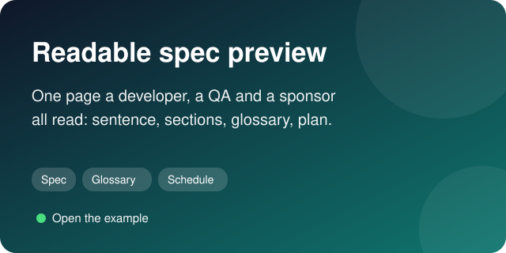
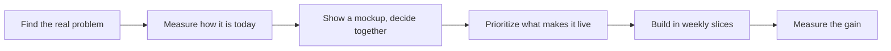
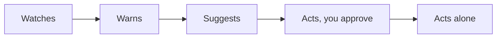

<h1 align="center">Hi, I'm Ben 👋</h1>

<b>Product leader in São Paulo. I find the problem worth solving, prioritize what makes it live, and build it with AI, without the slop.</b>

## About me

Seventeen years building and scaling digital products, from early-stage ideas to a B2B SaaS platform used by thousands of real estate businesses, as VP Product & Growth, CEO and founder. Since 2023 I build AI products and agentic systems, I teach product, executive and engineering teams to work with them, and I spend most of my energy on the two things that decide whether any of it pays off: finding the real problem, and prioritizing the work so the team finds its pace.

### What I build: agentic systems with a measured return

The sales solution I built most recently is a multi-agent system that prepares a salesperson for a meeting. It researches the account, qualifies it, finds similar customers worth prospecting, and assembles the preparation that used to take up to two days, in about thirty minutes. Adoption reached 90% of the teams that use it, and each person gets one to two hours a day back. Before that, a WhatsApp sales workflow for a high-volume operation: 100% of first contacts answered for 2,000 to 3,000 leads a month, win rate from 20% to 42%, with a smaller team.

What they have in common: deterministic steps where the process is known, a model only where judgment is needed, a person approving anything that writes to the system of record until the agent has earned that tier, and a number agreed before the build.

### Two ways I work, one discipline

- **Forward-deployed.** Inside a client's operation, building a customized solution on their data and their process: fourteen days of discovery and process redesign, a baseline KPI, prototype validation, then sixty to ninety days to production.
- **Product building.** A product for many customers, where discovery means interviews, prototypes and a Now / Next / Later roadmap that survives contact with a sales team.

Same objective in both: a real problem with impact for the people who have it, an ROI agreed before building, and prioritization treated as seriously as discovery, because a backlog cut in the right order is what lets a team find its best pace.

### Prioritization is half the job

Epics, Features, User Stories and tasks, placed in Now / Next / Later, scored by ROI impact, and sequenced by the chain of what has to exist first: the small features that carry little value alone but make the first big one live. Functional and technical specs rendered as readable HTML that a developer, a QA or a non-technical sponsor reads without a meeting. And a live sprint simulation: Fibonacci points, the developers by name, the team's weekly capacity, and the date the epic lands, recomputed as you move a story. All of it is public below, with an interactive version.

### Visual AI slop is manageable

AI builds a screen in minutes, and the default result looks like every other AI screen. In 2026 that costs credibility the moment a customer, a sponsor or a candidate opens it. Taste is the scarce input, and it can be learned: a small set of rules, real data in the mockup, a few checks you can measure. Product building and product design are not optional for a product manager anymore. A readable HTML mockup, validated with stakeholders before a line of production code, is still the fastest way to validate an idea, above all with people who are not technical, and it works the same for a custom solution and for an agentic system. The rules, the workflow and live mockups are below.

### Teaching

AI adoption programs I co-designed and delivered reached about 3,000 leaders, product managers and developers, including executive education with FGV, Secovi-SP and LARES: internal tools, agentic workflows, AI-assisted development.

## What you'll find here

<table>
  <tr>
    <td width="50%" valign="top">
      
      
<b>Backlog Writing System.</b> From problem frame to weekly cadence: Now / Next / Later with ROI impact and the enabling chain, readable spec previews, a live capacity simulation, evals as acceptance criteria for AI behavior. 21 skills, a fictional product run through every stage. <a href="https://benyoumen.github.io/backlog-writing-system/">Field guide</a> · <a href="https://benyoumen.github.io/backlog-writing-system/capacity.html">Capacity simulator</a>

    </td>
    <td width="50%" valign="top">
      
      
<b>No-slop design.</b> The visual tells of generated screens and what to do instead, the mockup-first workflow, and live mockups built on real-looking data, each next to its generic version. <a href="https://benyoumen.github.io/no-slop-design/">Mockup gallery</a> · <a href="https://github.com/Benyoumen/no-slop-design/blob/main/docs/visual-slop-tells.md">The tells</a>

    </td>
  </tr>
  <tr>
    <td width="50%" valign="top">
      
      
<b>NextStone.</b> A product concept built end to end: a marketplace where real estate developers meet investment funds, four roles, each with its own dashboard. <a href="https://benyoumen.github.io/nextstone-concept/">Live demo</a> · <a href="https://github.com/Benyoumen/nextstone-concept#readme">Problem, decision, proof, next</a>

    </td>
    <td width="50%" valign="top">
      
      
<b>Agent Design Principles.</b> How an agent earns autonomy on evidence, the write contract between a screen and the system of record, and design rules for screens people use all day. <a href="https://github.com/Benyoumen/agent-design-principles/blob/main/docs/principles.md">Principles</a>

    </td>
  </tr>
  <tr>
    <td width="50%" valign="top">
      
      
<b>PM Deck and Writing Skills.</b> Editorial rules, a build pipeline with QA gates, and the anti-slop rewrite pass for decks and project messages. The sample deck is rendered with its own rules. <a href="https://benyoumen.github.io/pm-deck-and-writing-skills/">Live deck</a>

    </td>
    <td width="50%" valign="top">
      
      
<b>Readable spec preview.</b> A functional and technical spec rendered as one page a developer, a QA and a sponsor can all read: one plain sentence per item, numbered sections, a glossary, phases and the schedule. <a href="https://benyoumen.github.io/backlog-writing-system/spec-preview.html">Open the example</a>

    </td>
  </tr>
</table>

Every example uses a fictional product and fictional data. Nothing comes from a customer or an employer.

## How I work, in plain words

*One loop, repeated. The number measured at the end is the first line of the next problem.*

*How an AI agent earns trust. Each step up needs proof: tests on real cases, weeks of shadow use, zero forbidden actions.*

## Background

- Seventeen years in product, B2B SaaS, growth and digital platforms. Former VP Product & Growth, CEO and founder.
- Two master's degrees in law and an MBA in real estate management (ESSEC). Trained in Paris, based in São Paulo, working internationally.
- Native French, fluent English and Portuguese.

## Open to

**Head of AI Product · Director of Product · Head of Product · Group PM · Senior AI PM**

Remote roles across the US, Europe and Latin America.
