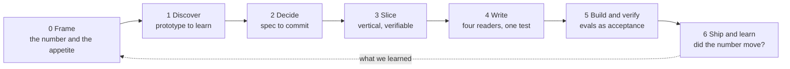
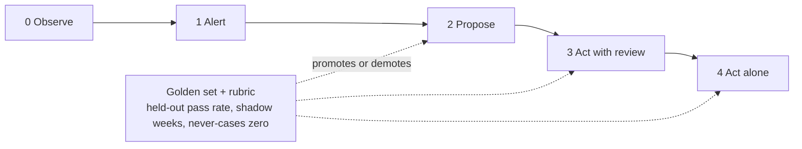

## Hi, I'm Benjamin

Product leader based in São Paulo, building AI products and agents. Native French, fluent English and Portuguese.

I work on the part of AI products that decides whether they survive contact with real users: how an agent earns autonomy, what it is allowed to write to the system of record, and how the work is written down so a team, and now a coding agent, can ship it. This profile holds those methods, written as reusable skills with fictional examples, and one product concept built end to end.

**Open to:** Head of AI Product, Senior AI PM, Director or Group PM. Remote, US or Europe.

## Projects

<table>
  <tr>
    <td width="50%" valign="top">
      
      
<b>Backlog Writing System.</b> A complete method from problem frame to weekly cadence: 18 skills, 14 templates, a fictional product run through every stage, and evals as acceptance criteria for AI behavior. <a href="https://benyoumen.github.io/backlog-writing-system/">Field guide</a> · <a href="https://github.com/Benyoumen/backlog-writing-system/blob/main/docs/manifesto.md">Manifesto</a>

    </td>
    <td width="50%" valign="top">
      
      
<b>NextStone.</b> A product concept: a marketplace where real estate developers meet investment funds. Four roles, each with its own dashboard, built as a working MVP. <a href="https://benyoumen.github.io/nextstone-concept/">Live demo</a> · <a href="https://github.com/Benyoumen/nextstone-concept#readme">Problem, decision, proof, next</a>

    </td>
  </tr>
  <tr>
    <td width="50%" valign="top">
      
      
<b>Agent Design Principles.</b> UX rules for products where an AI agent acts for a person: autonomy tiers gated by evals, the write contract between a screen and the system of record, dense operator screens. <a href="https://github.com/Benyoumen/agent-design-principles/blob/main/docs/principles.md">Principles</a>

    </td>
    <td width="50%" valign="top">
      
      
<b>PM Deck and Writing Skills.</b> Editorial rules and a QA pipeline for decks and project messages, plus an anti-slop rewrite guide. The sample deck is rendered with the repository's own rules. <a href="https://benyoumen.github.io/pm-deck-and-writing-skills/">Live deck</a>

    </td>
  </tr>
</table>

## How I think about a backlog

## How I think about agent autonomy

All examples in these repositories use a fictional product and fictional data. Nothing here comes from a customer or an employer.
